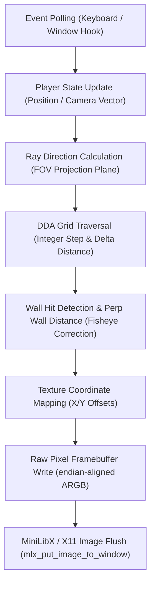

# cub3d — Real-Time Fixed-Point Raycasting Engine


A real-time 3D software rendering engine implemented in pure C, inspired by Wolfenstein 3D. Engineered without hardware graphics acceleration (zero OpenGL/Vulkan/DirectX dependencies), executing ray-plane projections directly to raw framebuffers via the Digital Differential Analysis (DDA) grid traversal algorithm.

---

## Technical Architecture & Pipeline

The engine maintains a 60 FPS deterministic game loop: polling keyboard events, updating position and camera orientation vectors, calculating ray-grid intersections, sampling wall textures, and writing contiguous pixel arrays directly to X11 image memory before vertical sync.



### Core Engine Systems

1. **Digital Differential Analysis (DDA)**:
   - Computes ray intersections through a 2D integer grid in $O(1)$ amortized time per step.
   - Eliminates floating-point trigonometric recalculation in the inner render loop by leveraging perpendicular distance projection ($P_{\text{dist}} = \frac{X_{\text{map}} - X_{\text{pos}} + \frac{1 - \text{step}_x}{2}}{\text{rayDir}_x}$), completely removing fisheye distortion artifacts.

2. **Direct Framebuffer Rasterization**:
   - Bypasses individual pixel draw syscalls (`mlx_pixel_put`), eliminating per-pixel context switches.
   - Allocates a contiguous raw image buffer (`char *addr` with 32-bit color depth), writing pitch-aligned memory words directly before atomic blit to the X11 display.

3. **Deterministic Map Parser & Boundary Verification**:
   - Multi-stage lexical parser validating coordinate blocks, color definitions (RGB floor and ceiling values), and texture assets.
   - Flood-fill verification verifying that all navigable player spaces are strictly enclosed by perimeter walls (`1`), preventing out-of-bounds memory dereferencing.

---

## Technical Specifications

| Subsystem | Implementation Details | Invariant / Target |
| :--- | :--- | :--- |
| **Language & Standard** | Pure C (ISO/IEC 9899:1999) | `-Wall -Wextra -Werror -O3` |
| **Raycasting Algorithm**| Digital Differential Analysis (DDA) | Constant-time grid stepping |
| **Projection Model** | Camera Plane Vectors (`dir`, `plane`) | Distortion-free FOV (66°) |
| **Memory Strategy** | Monolithic allocation, zero heap leaks | Deterministic teardown |
| **Texture Engine** | Custom XPM texture decoder & bilinear sampling | 64x64 texture normalization |
| **Input Handling** | Continuous non-blocking keymask tracking | Fluid strafe and rotation |

---

## Build & Execution

### Compilation

```bash
# Compile optimized production binary (-O3)
make

# Clean build artifacts
make clean

# Full rebuild
make re
```

### Execution

```bash
# Launch with standard test scenario
./cub3D maps/good/subject_map.cub
```

### Controls

| Action | Keybinding |
| :--- | :--- |
| **Translation** | `W` (Forward), `S` (Backward), `A` (Strafe Left), `D` (Strafe Right) |
| **Rotation** | `←` / `→` (Yaw rotation) |
| **Termination** | `ESC` or Window Close (Clean memory release) |

---

## Author & Engineering Standards

**Rubén D. Higuita** — Systems & Embedded Software Engineer  
Madrid, Spain • [LinkedIn](https://www.linkedin.com/in/higrub89/) • [GitHub](https://github.com/higrub89) • [Portfolio](https://higrub89.github.io)

```text
Engineering Invariant:
Software-rendered raycasting with direct memory writes, strict map validation, and zero heap corruption.
```
